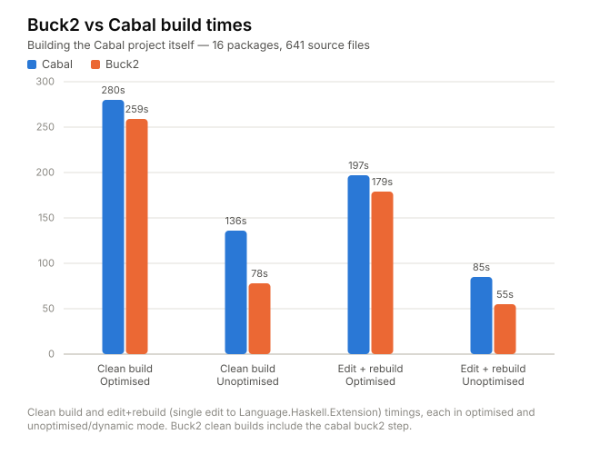

# Buck2 build system for Haskell projects

Short summary: this is a [cabal external command][ext] `cabal buck2`
that allows you to use [Buck2](https://buck2.build) as the build
system for your Cabal project.

# Quick start

First [download a buck2
binary](https://buck2.build/docs/getting_started/install/), unpack it
and put it on your `PATH`.

Then

```
cabal install cabal-buck2
```

Then in the root of your project or package:

```
cabal buck2 --enable-tests
```

The first time, this creates a `buck2/` directory with the Buck2
support code (the rules for Haskell and the Buck2 prelude). It is
copied from the copy that was installed with `cabal-buck2`, so it is
always the right version for the `cabal-buck2` you have. When you
upgrade `cabal-buck2`, the next `cabal buck2` replaces `buck2/` with
the new version. You probably want to add `buck2/` to your
`.gitignore`.

If you want to change the support code, or use a version of it that
isn't released yet, you can use a git checkout of the corresponding
branch of [haskell-buck2](https://github.com/simonmar/haskell-buck2)
instead:

```
git clone https://github.com/simonmar/haskell-buck2.git buck2 -b <version>
```

Where `<version>` is the version of `cabal-buck2`, e.g. `0.6.0.0`.
`cabal buck2` never replaces a `buck2/` that it didn't create
itself. Instead it checks that `buck2/` is for its release (the
`CABAL_BUCK2_VERSION` in `buck2/version.bzl`), and so does buck2 when
it reads the files that `cabal buck2` generated. If they don't match,
the error says which branch to switch to.

Then you can use `buck2` as the build tool, e.g.

```
buck2 build //...
```

To build all the components, or

```
buck2 test //...
```

To run your tests.

Note that you need to re-run `cabal buck2 --enable-tests` if you
modify the `cabal.project` or any of the `.cabal` files.

Not all Cabal features are supported - see [limitations](#limitations).

# Why?

(skip this section if you know why you want buck2)

Why might you want to use `buck2` as the build system compared with
just using `cabal`? Well, first off let me be clear that you *still
need Cabal*, because the Buck2 support doesn't know how to solve
package dependencies or build them. So the workflow consists of first
running `cabal buck2` to solve and build the dependencies, but once you've
done that you can switch to `buck2` for building. The idea is that
`buck2` is a more pleasant experience because:

* It's [faster than Cabal, particularly for rebuilds](#performance).

* It supports different build modes out of the box: the default is to
  build in `dev` mode (unoptimised with dynamic linking) but adding
  `-m opt` gives you optimisation and static linking. Note that Cabal
  doesn't have a purely dynamic build mode: it always uses `-dynamic-too`
  for libraries, which has a significant built-time performance cost.

* The Buck2 build is extensible. If you have anything that needs to be
  generated as part of your build, or any non-standard tooling, then
  hooking that up using Buck2 is far easier than Cabal.  Furthermore
  Buck2 knows how to rebuild things correctly when either the build
  system or the code generator components change.

* It works a lot better than Cabal when you have non-Haskell code (e.g. C/C++ or Rust) in your project, because
  * Buck2 understands dependencies between C/C++ source files and header files (Cabal doesn't: [issue #4306](https://github.com/haskell/cabal/issues/4306)), so when you modify a C/C++ header the correct things are rebuilt.
  * Buck2 builds C/C++ files in parallel, while Cabal doesn't ([issue #7127](https://github.com/haskell/cabal/issues/7127))

* You can use [remote execution and caching](https://buck2.build/docs/users/remote_execution/). There is built-in support for using a build cache, see [Sharing build results (a build cache)](#sharing-build-results-a-build-cache) below.

Finally, if you have an existing codebase using Buck2 then this is the
basis of something that could "buckify" Cabal packages to integrate
into your build system. It needs a bit of work to be suitable for that
use case, though: `cabal buck2` builds all the external dependencies
and installs them in the Cabal store, whereas to integrate with an
existing build system you would want to satisfy those external
dependencies from the build system itself.

# How complete is it?

I've used it to build a few large projects, in particular the Cabal
project itself which consists of about 16 packages and a few hundred
source files. It can also build [Glean](https://glean.software), which
has some complex build requirements including custom codegen, FFI &
hsc2hs.

There are a few [limitations](#limitations), however.

# What `cabal buck2` does

You can run `cabal buck2` in a project or a single Cabal package. It
does the following:

1. Solves the `build-depends` constraints of your package(s) and
   builds all the dependencies, much like `cabal build all --only-dependencies`
   would.

2. Generates some files, notably:

   * `BUCK` and `BUCK.cabal.bzl` in each package, these are the Buck2
     build targets

   * `cabal-buck2/autogen` in each package, this is where we put the
     files that Cabal autogenerates, such as `cabal_macros.h` and
     `Paths_<pkg>.hs`.

   * `cabal-buck2/packages.bzl` in the root of the project, which says
     where each of your packages is. Nothing in a package's
     `BUCK.cabal.bzl` says where it is or where the packages it depends
     on are, so moving a package, or building it as part of a bigger
     project, only changes this file. (All the packages have to be in
     the one Buck2 cell, the root.)

   * `third-party/haskell`: tells Buck2 about all the prebuilt package
     dependencies, either in the Cabal store or in GHC's package
     DB (unless you build the dependencies from source, see below). In here we also record the GHC version you're using, and the
     paths to any tool dependencies.

A component that can't be built with buck2 (e.g. `build-type: Custom`)
is an error: `cabal buck2` lists them and aborts, unless you give the
`--keep-going` flag in which case it will translate everything it
can and warn about the missing components.

# Buck2 quick start

To build your code:

```
buck2 build //...
```

The `//...` is Buck2's syntax for "all targets recursively below the
current directory". You can also build specific target(s), for example
`buck2 build cabal-install:cabal` would build the `cabal` target in
the `cabal-install` package. For more details see [Target
Pattern](https://buck2.build/docs/concepts/target_pattern/) in the
Buck2 docs.

Next you can run your tests:

```
buck2 test //...
```

# Customising the build

`cabal buck2` will generate all the `BUCK` files if they don't exist,
but you can also write your own if you want (`cabal buck2` won't
overwrite them).

The `BUCK` file usually goes in the same directory as your source
files. The targets that `cabal buck2` produces go in the
`BUCK.cabal.bzl` file, and are generated by a call to
`generated_targets()` from the `BUCK` file. This call takes some
arguments that you can use to override or transform the generated
targets - take a look at the comments in the generated code to see
how.

The overrides can also go in a `cabal-buck2.bzl` file in the root of
the project, for all of its packages at once, which is useful when a
package's directory isn't yours to add files to (a git submodule, say):

```
OVERRIDES = {
    # package name -> component name -> extra attributes
    "my-package": {
        "my-package": {"compiler_flags": ["-O2"]},
    },
}
```

`cabal-buck2.bzl` can also give defaults for the generated targets,
for every package (`"*"`) or for one package. Each package's defaults
are keyed by the kind of target (`"library"`, `"executable"`,
`"test-suite"` or `"benchmark"`), or by `"*"` for every kind. For
example, to compile every target of the project module by module:

```
DEFAULTS = {
    # package name or "*" -> kind or "*" -> extra attributes
    "*": {
        "*": {"per_module": True},
    },
}
```

The attributes are merged into the generated ones: lists are appended
to, dicts are merged, and anything else is replaced. The overrides of
a component win over all of the defaults, and the defaults for a
package win over the defaults for every package. See
`cabal_targets()` in `buck2/cabal.bzl` for the details.

Re-run `cabal buck2` after adding or removing `cabal-buck2.bzl`, or
adding or removing its `OVERRIDES` or `DEFAULTS`.

You can also completely override the generated targets and write a
`BUCK` file with your own rules, while still making use of the
pre-built dependencies that `cabal buck2` produces.  For example, the
`BUCK` file for a simple Haskell library might look something like

```
load("//buck2:haskell.bzl", "haskell_library")

haskell_library(
    name = "my-package",
    srcs = [
        "Some/Module.hs",
    ],
    packages = [
        "unordered-containers",
    ],
    visibility = ["PUBLIC"],
)
```

and the `BUCK` file for a test might look like

```
load("//buck2:haskell.bzl", "haskell_test")

haskell_test(
    name = "my-test",
    srcs = {
        "Main.hs" : "my-test.hs",
    },
    deps = [
        "//:my-package",
    ],
    packages = [
        "test-framework",
        "test-framework-hunit",
        "HUnit",
    ],
)
```

You can find docs on how to write `BUCK` files in the Buck2 docs, e.g. [haskell_library](https://buck2.build/docs/prelude/rules/haskell/haskell_library/).

## Runtime tool dependencies

Cabal provides a way to indicate build-time tool dependencies with
`build-tool-depends`, but it also treats these as _runtime_ tool dependencies
(i.e. it puts them on the `PATH` for test runs and `cabal run`s of executables).

If we don't distinguish these, then `haskell-buck2` must build all `build-tool-depends`
in both the build and target configurations, which means they will be built twice.

For this reason we provide a way to fill in the "missing" Cabal `run-tool-depends` 
field (proposed in [haskell/cabal#5411](https://github.com/haskell/cabal/issues/5411)).

This works as follows:

```
test-suite tests
  -- So `cabal test` continues to work.
  build-tool-depends: my-package:my-exe
  -- Not truly needed to _build_ the test-suite...
  x-buck2-ignore-build-tool-depends: my-package:my-exe
  -- Needed when the test suite runs 
  x-buck2-run-tool-depends: my-package:my-exe
```

If `x-buck2-run-tool-depends` is present, we assume that it is accurate, and 
so do not consider `build-tool-depends` to be runtime dependencies. If 
`x-buck2-run-tool-depends` is not present, we assume that we have to mimic 
Cabal's behaviour, and so `build-tool-depends` will also be considered runtime dependencies.

## Template Haskell dependencies

With `haskell-buck2`'s per-module compilation, modules using Template Haskell
can only compile once the libraries that they use are linked.
Cabal's `build-depends` doesn't say which libraries are actually used in TH,
so by default a Template Haskell module has to wait for all of them.

A component can list the libraries that its splices run in
`x-buck2-template-haskell-depends`. This fills in the "missing" Cabal
`template-haskell-depends` field (proposed in
[haskell/cabal#12583](https://github.com/haskell/cabal/issues/12583)).

```
library
  build-depends: base, aeson, my-codegen
  -- Only my-codegen's code runs in the splices.
  x-buck2-template-haskell-depends: my-codegen
```

The libraries must also be in `build-depends` so that cabal can link them.

If `x-buck2-template-haskell-depends` is present, we assume that it is
accurate. If the field is not present, we are pessimistic and assume that
a Template Haskell module may use any of the component's libraries.

## The compilers

Buck2 builds with the tools that `cabal buck2` found when it last ran, not
with whatever is on the `PATH` of the shell you run `buck2` in. So after
changing your tools (a different GHC, or a different Nix shell), re-run
`cabal buck2`; restarting buck2 isn't needed. (`cabal buck2` puts a symlink to
each of them in `third-party/haskell/toolchain`.)

* GHC is the one that `cabal` uses (`-w` chooses another), and `ghc-pkg`,
  `hsc2hs` and `haddock` are those that `cabal` finds (normally next to
  GHC; use `--with-hsc2hs` and so on choose different ones).
* The C and C++ compilers, for your packages' C and C++ sources, are:
  * the C compiler you give `cabal` for `gcc`, with `--with-gcc`, or in
    `cabal.project` (or `cabal.project.local`):
    ```
    program-locations
      gcc-location: clang
    ```
    and the C++ compiler of the same name next to it (`clang++` for `clang`,
    `g++` for `gcc`, `clang++-18` for `clang-18`...). `cabal` uses the C
    compiler for the C of the packages it builds too.
  * otherwise GHC's, if it has an absolute path for "C compiler
    command" in `ghc --info` (as a GHC built by Nix
    does);
  * otherwise `clang` and `clang++`, linking with `g++`. These are the
    Buck2 toolchain defaults.

# Build modes

The Buck2 build system has the following build mode options, which can
be selected using `-m` on the Buck2 command line (e.g. `-m opt`)

  * Optimisation:
    * `dev`: (default) no optimisation, `-g` for C/C++.
    * `opt`: adds `-O` for Haskell, `-O3 -DNDEBUG` for C/C++, and also enables
      `static` unless overridden by `shared`.
  * Linking:
    * `shared`: (default) shared libraries, dynamic linking
    * `static`: static linking, but also builds shared libraries using
    `-dynamic-too` because those are required for Template Haskell.
  * Profiling:
    * `prof`: enables Haskell profiling; also forces `static`.

To use any of these modes, add them using `-m` on the command line:

```
buck2 build my-package:my-program -m opt
```

# Sharing build results (a build cache)

By default buck2 keeps nothing between runs of its daemon, nor between
checkouts: after `buck2 kill`, or in a new worktree, everything is built again.
A cache of build results fixes that. Buck2 can use any server that implements
the Bazel remote execution API's action cache and CAS, **only to look results
up and store them: nothing is run remotely**. For example
[bazel-remote](https://github.com/buchgr/bazel-remote):

```
bazel-remote --dir ~/.cache/buck2 --max_size 20 --grpc_address 127.0.0.1:9092 --http_address 127.0.0.1:8080
cabal buck2 --cache=grpc://127.0.0.1:9092
```

`--cache` adds a block to `.buckconfig.local` (between
`# >>> cabal buck2: cache` and `# <<< cabal buck2: cache <<<`; anything else in
the file is left alone), which later runs keep. `cabal buck2 --no-cache` removes
it. `.buckconfig.local` is for the settings of one checkout and isn't usually
committed (add it to `.gitignore`); a project that wants everyone to use the
same cache can copy the block into `.buckconfig` instead. **Run
`buck2 kill` after changing it**: buck2 reads the cache's address when its
daemon starts, and a daemon that was already running keeps the old settings.

Things to know:

* **The server has to be running.** When it isn't, buck2 retries connecting
  for about 45 seconds on each build before carrying on without the cache.
  Re-run `cabal buck2` with `--no-cache` to stop using the cache.
* The key of a cached result includes the command line, the environment and
  the contents of the inputs. It includes the exact packages from the Cabal
  store (their unit ids), a fingerprint of the GHC installation (its version,
  platform, source commit and the interface hashes of its boot packages) and
  a fingerprint of the C toolchain (the versions of the C compiler, `ld`, the
  C library and `libstdc++`). It does **not** include other files that are
  found on the system, such as headers and libraries that are not part of
  those. That is fine on one machine; **sharing a cache between machines with
  different system software is not safe yet**.
* Compiling and linking C/C++ code is cached, `pkg-config` queries are not.
* **buck2 only downloads what is needed.** A result that is found in the cache
  is not downloaded until something needs its files: a local action that has
  it as an input, `buck2 run` or `buck2 test`, or it is what you asked to
  build. So most intermediate results (the compiled modules of a library
  that was cached as a whole, say) are never fetched. `buck2 build -M none
  //...` goes further and does not download what you asked for either, which
  is a fast way to find out whether everything is already in the cache: the
  summary line shows how many actions were cache hits.

# Building the dependencies with buck2

By default the dependencies of your packages are built by `cabal`, into its
store, and Buck2 uses them from there. With `--source-deps` Buck2 builds them
too:

```
cabal buck2 --source-deps
```

The source of each dependency is unpacked under `dist-newstyle/src` and the
package gets a `BUCK` and `BUCK.cabal.bzl` like those of your own packages.
Only the packages that come with GHC are used from its package database; the
build then doesn't depend on the Cabal store at all. Together with a
[build cache](#sharing-build-results-a-build-cache) that means a dependency is
built once, and then found in the cache by every other checkout, which is the
job the store does for `cabal`.

Things to know:

* If any dependency package isn't supported by `cabal buck2`,
  `--source-deps` will fail. The most common cause of this is a
  package that uses `build-type: Custom` (see
  [Custom build type](#custom-build-type)). In case of failure you can
  either fall back to not using `--source-deps` or use `--keep-going`
  to continue without the unsupported dependencies.
* Running `cabal buck2` again without `--source-deps` goes back to the store,
  and removes the packages that were unpacked for the previous run.
* The tools that dependencies need to preprocess sources (`alex` and `happy`)
  are built by buck2 too, when the project needs them.
* The build plan can only have one version of each package, because a package
  in a `.cabal` file is referred to by its name. `cabal buck2` stops and lists
  the packages that need more than one.

# Performance

I ran some experiments building the Cabal project itself - 16 packages
and 641 source files (one package, `hackage-security`, is not part of
the project but has to be built locally nonetheless because it depends
on `Cabal-syntax` which *is* part of the project).

Buck2 shines when it comes to rebuilds: the dependency graph is cached
in memory, and it knows when build steps can be omitted because the
inputs haven't changed.



**Caveats**

* Results tend to be +/- a few seconds from run to run
* I didn't dig into the results in any detail
* It's just one set of data points. Different projects and different choices of edits could give different results. However, I did perform a similar
experiment with the [persistent](https://github.com/yesodweb/persistent)
project, and got similar results.

## Raw results and details

### Clean build

* Optimised:
  * Default Cabal build: **280s**
    * `cabal build all --enable-tests --enable-benchmarks -j`
  * Buck2 build (opt mode, including `cabal buck2`): **259s**
    * `cabal buck2 --enable-tests --enable-benchmarks && buck2 build //... -m opt`
    * Not much difference here, as we expect.

* Unoptimised / dynamic:
  * Cabal build with -O0 -dynamic: **136s**
    * `cabal build all --enable-tests --enable-benchmarks -j --disable-optimisation --enable-executable-dynamic`
  * Buck2 build (dev mode, including `cabal buck2`): **78s**
    * `cabal buck2 --enable-tests --enable-benchmarks && buck2 build //... -m dev`
    * Cabal is using `-dynamic-too` for libraries, while Buck2 is building everything purely dynamic.

### Edit + rebuild

Next I made a single edit (added an extension to
`Language.Haskell.Extension`) and rebuilt everything:

* Optimised:
  * Cabal: **197s**
  * Buck2: **179s**

* Unoptimised / dynamic:
  * Cabal: **85s**
  * Buck2: **55s**

# Limitations

## It's an external command, not builtin to `cabal-install`

This has some implications:

* `cabal` passes only the arguments after `buck2`, so global flags
  given before it (`cabal --store-dir=... buck2`) don't reach the
  tool. Use the environment (`CABAL_DIR`) instead.

* Nothing checks that your `cabal` binary matches the version of the
  `cabal-install` library that `cabal-buck2` was built against. Try to
  make sure they match, or confusion will undoubtedly ensue.

## Builds currently use `--make`

The current Buck2 prelude uses `ghc --make` to build each component
(library, executable). Ideally we should expose the full per-module
dependencies to Buck2 so that it can exploit parallelism across
packages for faster builds/rebuilds. It's entirely possible to do
this, indeed the functionality already exists in [Tweag's Haskell/Buck2
integration](https://github.com/tweag/buck2-haskell).

## Custom build type

Build-type `Custom` isn't supported, and can't be in general, so
`cabal buck2` will fail if any package requires it. Note that this
also applies to dependencies when `--source-deps` is being used.  As
with other unsupported features, you can use `--keep-going` to just
skip all the affected packages.

If a package's `Setup.hs` isn't needed by your build, or what it
does can be done some other way, `--enable-custom-setup` builds it as
if it had `build-type: Simple` (or `Configure`, if it has a
`configure` script). The modules that its `Setup.hs` would generate
(its `autogen-modules`) must then be given by the project, in the
overrides of the component (see [Customising the build](#customising-the-build)),
for example

```
OVERRIDES = {
    "my-package": {
        "my-package": {"srcs": {"My.Generated.Module": "//gen:my-module"}},
    },
}
```

## Hooks build type

There is partial support for `build-type: Hooks`: only configure hooks
are supported so far; files generated by pre-build rules are not.

The `SetupHooks` executable is built (by cabal) during `cabal buck2`,
including the package's `setup-depends`. It has to be built with the
same Cabal version as `cabal-buck2`, so `cabal-buck2` injects a
solver constraint to ensure that.

## No support for Cabal's `foreign-library`

Nothing fundamental blocking this, it's just a TODO.

## Preprocessors like `hspec-discover`

The `hspec-discover` preprocessor is designed to be invoked by GHC via
the `-pgmF` flag to specify a custom preprocessor. The problem is that
`hspec-discover` searches the filesystem to find other source files;
these other source files amount to implicit inputs to the compilation,
but when using Buck2 all inputs must be explicit (this is so that
compilation steps can be executed remotely).

To build an `hspec-discover` test with Buck2, you have to run the
preprocessor using a `genrule()` that takes all the source files as an
input. For example, if your test is in `test/Spec.hs`:

```
filegroup(
    name = "srcs",
    srcs = glob(["**/*.hs"])
)

genrule(
    name = 'spec-gen',
    cmd = "$(location third-party-haskell//:hspec-discover-exe) $(location :srcs)/test/Spec.hs test/Spec.hs ${OUT}",
    out = "test/Spec.hs"
)

haskell_test(
    name = 'spec',
    srcs = {
        'Main.hs': ':spec-gen',
        ...
    },
    ...
)
```

# Acknowledgments

Most of the code and modifications to the standard Buck2 prelude were
developed with the help of Claude Code using Claude Sonnet 5/5.5.

The Haskell support already in the Buck2 prelude was developed by Meta
and is in production use internally for building
[Glean](https://glean.software). This project just fixes a few things
and adds some functionality needed to support building Cabal projects.

# Related projects

[Tweag](https://tweag.io) also worked on a [Haskell integration for
Buck2](https://www.youtube.com/watch?v=bbFnrTAIK9Q). This project has
no code in common with theirs, except for the shared upstream prelude
code. Tweag's integration is more sophisticated and was aimed at using
Buck2's improved scalability to build large Haskell projects.

[ext]: https://cabal.readthedocs.io/en/stable/external-commands.html
