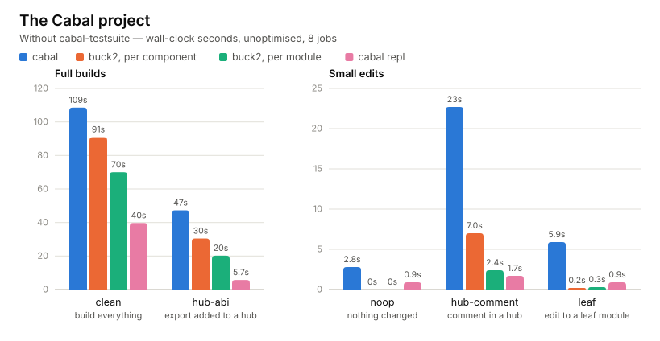
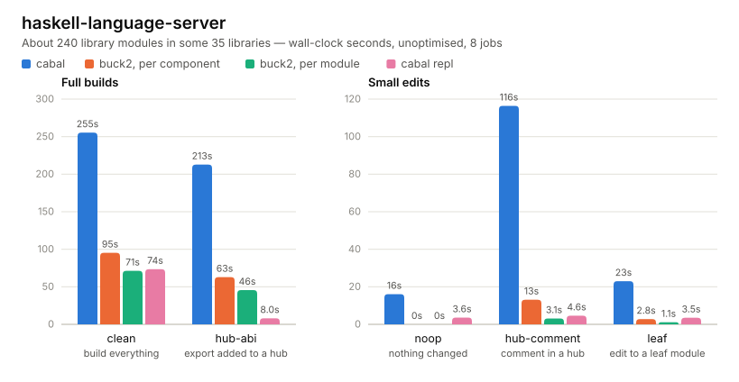
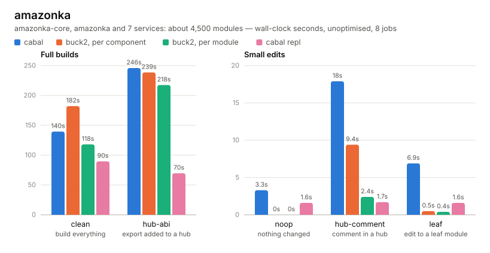

# Buck2 build system for Haskell projects

Short summary: this is a [cabal external command][ext] `cabal buck2`
that allows you to use [Buck2](https://buck2.build) as the build
system for your Cabal project.

# Quick start

First [download a buck2
binary](https://buck2.build/docs/getting_started/install/), unpack it
and put it on your `PATH`.

Then

```
cabal install cabal-buck2
```

Then in the root of your project or package:

```
cabal buck2 --enable-tests
```

Then you can use `buck2` as the build tool, e.g.

```
buck2 build //...
```

To build all the components, or

```
buck2 test //...
```

To run your tests.

Note that you need to re-run `cabal buck2 --enable-tests` if you
modify the `cabal.project` or any of the `.cabal` files.

Most Cabal features are supported but not all - see [limitations](#limitations).

# Why?

(skip this section if you know why you want buck2)

Why might you want to use `buck2` as the build system compared with
just using `cabal`? Well, first off let me be clear that you *still
need Cabal*, because the Buck2 support doesn't know how to solve
package dependencies or build them. So the workflow consists of first
running `cabal buck2` to solve and build the dependencies, but once
you've done that you can switch to `buck2` for building and running
tests. The idea is that `buck2` is a more pleasant experience because:

* It's [faster than Cabal, particularly for rebuilds](#performance).

* It supports different build modes out of the box: the default is to
  build in `dev` mode (unoptimised with dynamic linking) but adding
  `-m opt` gives you optimisation and static linking. Note that Cabal
  doesn't have a purely dynamic build mode: it always uses `-dynamic-too`
  for libraries, which has a significant build-time performance cost.

* It works a lot better than Cabal when you have non-Haskell code (e.g. C/C++ or Rust) in your project, because
  * Buck2 understands dependencies between C/C++ source files and header files (Cabal doesn't: [issue #4306](https://github.com/haskell/cabal/issues/4306)), so when you modify a C/C++ header the correct things are rebuilt.
  * Buck2 builds C/C++ files in parallel, while Cabal doesn't ([issue #7127](https://github.com/haskell/cabal/issues/7127))

* There is support for using a build cache; see [Sharing build results
  (a build cache)](#sharing-build-results-a-build-cache). A build
  cache means that if you need to quickly create a new worktree to
  work on a new feature or bugfix, for example, the build in the new
  worktree is mostly fetched from the cache instead of being rebuilt.

* The Buck2 build is extensible. If you have anything that needs to be
  generated as part of your build, or any non-standard tooling, then
  hooking that up using Buck2 is far easier than Cabal.  Furthermore
  Buck2 knows how to rebuild things correctly when either the build
  system or the code generator components change.

Finally, if you have an existing codebase using Buck2 then this is the
basis of something that could "buckify" Cabal packages to integrate
into your build system. It needs a bit of work to be suitable for that
use case, though: `cabal buck2` builds all the external dependencies
and installs them in the Cabal store, whereas to integrate with an
existing build system you would want to satisfy those external
dependencies from the build system itself.

# How complete is it?

We've used it to build a few large projects, for instance the Cabal
project itself, the Haskell Language Server, and
[Amazonka](https://github.com/brendanhay/amazonka). It can also
build [Glean](https://glean.software), which has some complex build
requirements including custom codegen, FFI & hsc2hs.

There are a few [limitations](#limitations), however.

# What `cabal buck2` does

You can run `cabal buck2` in a project or a single Cabal package. It
does the following:

1. Solves the `build-depends` constraints of your package(s) and
   builds all the dependencies, much like `cabal build all --only-dependencies`
   would.

2. Generates some files, notably:

   * The `buck2/` directory containing the Buck2 support code;

   * `.buckconfig`, containing build-wide configuration options, and
     `PACKAGE`, which sets the default build mode. `cabal buck2` only
     creates these two files if they don't exist, so you can edit
     them;

   * `.buckconfig.local`, if you use a [build
     cache](#sharing-build-results-a-build-cache);

   * `BUCK` and `BUCK.cabal.bzl` in each package, these are the Buck2
     build targets;

   * `cabal-buck2/autogen` in each package, this is where we put the
     files that Cabal autogenerates, such as `cabal_macros.h` and
     `Paths_<pkg>.hs`;

   * `cabal-buck2/packages.bzl` in the root of the project, which says
     where each of your packages is. The `BUCK.cabal.bzl` files don't
     say where any package is, so moving a package, or building it as
     part of a bigger project, only changes this file. (All the
     packages have to be in the one Buck2 cell, the root.)

   * `third-party/haskell`: tells Buck2 about all the prebuilt package
     dependencies, either in GHC's package DB or the Cabal store
     (unless you [build the dependencies from
     source](#building-the-dependencies-with-buck2)). In here we also
     record the GHC version you're using, and the paths to any tool
     dependencies.

A component that can't be built with buck2 (e.g. `build-type: Custom`)
is an error: `cabal buck2` lists them and aborts, unless you give the
`--keep-going` flag in which case it will translate everything it
can and warn about the missing components.

# Using Buck2

## Quick start

To build your code:

```
buck2 build //...
```

The `//...` is Buck2's syntax for "all targets recursively below the
root of the project". You can also build specific target(s), for example
`buck2 build cabal-install:cabal` would build the `cabal` target in
the `cabal-install` package. For more details see [Target
Pattern](https://buck2.build/docs/concepts/target_pattern/) in the
Buck2 docs.

To see the targets that a package has, run:

```
buck2 targets //<package>/...
```

Next you can run your tests:

```
buck2 test //...
```

## Build modes

The Buck2 build system has the following build mode options, which can
be selected using `-m` on the Buck2 command line (e.g. `-m opt`)

  * Optimisation:
    * `dev`: (default) no optimisation, `-g` for C/C++.
    * `opt`: adds `-O` for Haskell, `-O3 -DNDEBUG` for C/C++, and also enables
      `static` unless overridden by `shared`.
  * Linking:
    * `shared`: (default) shared libraries, dynamic linking
    * `static`: static linking, but also builds shared libraries using
    `-dynamic-too` because those are required for Template Haskell.
  * Profiling:
    * `prof`: enables Haskell profiling; also forces `static`.

To use any of these modes, add them using `-m` on the command line:

```
buck2 build my-package:my-program -m opt
```

# Buck2-specific features in `.cabal`

`cabal buck2` recognises some extra fields in your `.cabal` file which affect how Buck2 builds the package; these are described in the sections below.

## Runtime tool dependencies

Cabal provides a way to indicate build-time tool dependencies with
`build-tool-depends`, but it also treats these as _runtime_ tool dependencies
(i.e. it puts them on the `PATH` for test runs and `cabal run`s of executables).

If we don't distinguish these, then all `build-tool-depends` must be
built in both the build and target configurations, which means they
will be built twice.

For this reason we provide a way to fill in the "missing" Cabal `run-tool-depends` 
field (proposed in [haskell/cabal#5411](https://github.com/haskell/cabal/issues/5411)).

This works as follows:

```
test-suite tests
  -- So `cabal test` continues to work.
  build-tool-depends: my-package:my-exe
  -- Not truly needed to _build_ the test-suite...
  x-buck2-ignore-build-tool-depends: my-package:my-exe
  -- Needed when the test suite runs 
  x-buck2-run-tool-depends: my-package:my-exe
```

If `x-buck2-run-tool-depends` is present, we assume that it is accurate, and 
so do not consider `build-tool-depends` to be runtime dependencies. If 
`x-buck2-run-tool-depends` is not present, we assume that we have to mimic 
Cabal's behaviour, and so `build-tool-depends` will also be considered runtime dependencies.

## Splice dependencies

With [Per-module compilation](#using-per-module-compilation), modules using Template Haskell
can only compile once the libraries that they use are linked.
Cabal's `build-depends` doesn't say which libraries are actually used in TH,
so by default a Template Haskell module has to wait for all of them.

A component can list the libraries whose code its splices run in
`x-buck2-splice-depends`. This fills in a "missing" Cabal field, proposed in
[haskell/cabal#12583](https://github.com/haskell/cabal/issues/12583).

```
library
  build-depends: base, aeson, my-codegen
  -- Only my-codegen's code runs in the splices.
  x-buck2-splice-depends: my-codegen
```

The libraries must also be in `build-depends` so that cabal can link them.

If `x-buck2-splice-depends` is present, we assume that it is
accurate. If the field is not present, we are pessimistic and assume that
a Template Haskell module may use any of the component's libraries.


# Customising the build

`cabal buck2` sets up the project so that Buck2 will build it exactly as Cabal would. However, it also provides various hooks that let you modify and customise the build, and these hooks are designed to survive re-running `cabal buck2` so you can have permanent Buck2-specific customisations in your project if you want.

## Configuring the build

The `.buckconfig` file has the build-wide configuration settings. Some of these are specific to Haskell targets; see the comments in the file for details. Typically this file will be checked-in and contain options that everyone building the project with Buck2 needs, so to set options for your local build only you can use `.buckconfig.local`. 

## Customising the rules

`cabal buck2` will generate all the `BUCK` files if they don't exist,
but you can also write your own if you want (`cabal buck2` won't
overwrite them).

The `BUCK` file usually goes in the same directory as your source
files. The targets that `cabal buck2` produces go in the
`BUCK.cabal.bzl` file, and are generated by a call to
`generated_targets()` from the `BUCK` file. This call takes some
arguments that you can use to override or transform the generated
targets - take a look at the comments in the generated code to see
how.

The overrides can also go in a `cabal-buck2.bzl` file in the root of
the project, for all of its packages at once, which is useful when a
package's directory isn't yours to add files to (a git submodule, say):

```
OVERRIDES = {
    # package name -> component name -> extra attributes
    "my-package": {
        "my-package": {"compiler_flags": ["-O2"]},
    },
}
```

`cabal-buck2.bzl` can also give defaults for the generated targets,
for every package (`"*"`) or for one package. Each package's defaults
are keyed by the kind of target (`"library"`, `"executable"`,
`"test-suite"` or `"benchmark"`), or by `"*"` for every kind. For
example, to compile every target of the project module by module:

```
DEFAULTS = {
    # package name or "*" -> kind or "*" -> extra attributes
    "*": {
        "*": {"per_module": True},
    },
}
```

The attributes are merged into the generated ones: lists are appended
to, dicts are merged, and anything else is replaced. The overrides of
a component win over all of the defaults, and the defaults for a
package win over the defaults for every package. See
`cabal_targets()` in `buck2/cabal.bzl` for the details.

Re-run `cabal buck2` after adding or removing `cabal-buck2.bzl`, or
adding or removing its `OVERRIDES` or `DEFAULTS`.

You can also completely override the generated targets and write a
`BUCK` file with your own rules, while still making use of the
pre-built dependencies that `cabal buck2` produces.  For example, the
`BUCK` file for a simple Haskell library might look something like

```
load("//buck2:haskell.bzl", "haskell_library")

haskell_library(
    name = "my-package",
    srcs = [
        "Some/Module.hs",
    ],
    packages = [
        "unordered-containers",
    ],
    visibility = ["PUBLIC"],
)
```

and the `BUCK` file for a test might look like

```
load("//buck2:haskell.bzl", "haskell_test")

haskell_test(
    name = "my-test",
    srcs = {
        "Main.hs" : "my-test.hs",
    },
    deps = [
        "//:my-package",
    ],
    packages = [
        "test-framework",
        "test-framework-hunit",
        "HUnit",
    ],
)
```

You can find docs on how to write `BUCK` files in the Buck2 docs, e.g. [haskell_library](https://buck2.build/docs/prelude/rules/haskell/haskell_library/).

## Modifying the support code under `buck2/`

If you want to change the support code, or use a version of it that
isn't released yet, you can use a git checkout of the corresponding
branch of [haskell-buck2](https://github.com/simonmar/haskell-buck2)
instead:

```
git clone https://github.com/simonmar/haskell-buck2.git buck2 -b <version>
```

Where `<version>` is the version of `cabal-buck2`, e.g. `0.6.0.0`.
`cabal buck2` never replaces a `buck2/` that it didn't create
itself. Instead it checks that `buck2/` is for its release (the
`CABAL_BUCK2_VERSION` in `buck2/version.bzl`), and so does buck2 when
it reads the files that `cabal buck2` generated. If they don't match,
the error says which branch to switch to.

## The compilers

Buck2 builds with the tools that `cabal buck2` found when it last ran, not
with whatever is on the `PATH` of the shell you run `buck2` in. So after
changing your tools (a different GHC, or a different Nix shell), re-run
`cabal buck2`; restarting buck2 isn't needed. (`cabal buck2` puts a symlink to
each of them in `third-party/haskell/toolchain`.)

* GHC is the one that `cabal` uses (`-w` chooses another), and `ghc-pkg`,
  `hsc2hs` and `haddock` are those that `cabal` finds (normally next to
  GHC; use `--with-hsc2hs` and so on choose different ones).
* The C and C++ compilers, for your packages' C and C++ sources, are:
  * the C compiler you give `cabal` for `gcc`, with `--with-gcc`, or in
    `cabal.project` (or `cabal.project.local`):
    ```
    program-locations
      gcc-location: clang
    ```
    and the C++ compiler of the same name next to it (`clang++` for `clang`,
    `g++` for `gcc`, `clang++-18` for `clang-18`...). `cabal` uses the C
    compiler for the C of the packages it builds too.
  * otherwise GHC's, if it has an absolute path for "C compiler
    command" in `ghc --info` (as a GHC built by Nix
    does);
  * otherwise `clang` and `clang++`, linking with `g++`. These are the
    Buck2 toolchain defaults.

# Using per-module compilation

By default Buck2 builds each library and executable using a single `ghc --make`, just as Cabal does. However, it can also compile each module separately which has significant advantages:

* The build can use more parallelism (Buck2 doesn't currently use `--make -j` and it doesn't use GHC's `-jsem`; while it would be easy to support `--make -j` there's no easy way to integrate `-jsem` with Buck2 so each compile would consume a fixed number of cores regardless of how many it actually needed.)
* Module dependencies ignore package boundaries, so a module's compile can begin as soon as the modules it depends on have been built. This can significantly increase the available parallelism beyond what `--make` could do.
* Incremental compiles are typically much faster, because a `--make` compile has to re-read interfaces for the whole library.
* We provide a persistent GHC worker to improve the performance of module-by-module compilation compared with using bare `ghc -c`. This is built automatically by Buck2 and used for per-module compilation unless you say otherwise in `.buckconfig`.

We currently consider per-module compilation as experimental so it has to be enabled explicitly: in your `.buckconfig` add

```
[haskell]
    compile_granularity = module
```

to enable per-module compilation for every target. It can also be enabled on a target-by-target basis using `cabal-buck2.bzl`: see [Customising the rules](#customising-the-rules).

The worker is built and used automatically; to disable it, add this to `.buckconfig`:

```
[haskell]
    per_module_worker = none
```

For more details, see [Per-module compilation](https://github.com/simonmar/haskell-buck2/tree/0.6.0.0#per-module-compilation-experimental) in the `haskell-buck2` docs.

# Sharing build results (a build cache)

By default buck2 keeps nothing between runs of its daemon, nor between
checkouts: after `buck2 kill`, or in a new worktree, everything is built again.
A cache of build results fixes that. Buck2 can use any server that implements
the Bazel remote execution API's action cache and CAS, **only to look results
up and store them: nothing is run remotely**. For example
[bazel-remote](https://github.com/buchgr/bazel-remote):

```
bazel-remote --dir ~/.cache/buck2 --max_size 20 --grpc_address 127.0.0.1:9092 --http_address 127.0.0.1:8080
cabal buck2 --cache=grpc://127.0.0.1:9092
```

`--cache` adds a block to `.buckconfig.local` (between
`# >>> cabal buck2: cache` and `# <<< cabal buck2: cache <<<`; anything else in
the file is left alone), which later runs keep. `cabal buck2 --no-cache` removes
it. `.buckconfig.local` is for the settings of one checkout and isn't usually
committed (add it to `.gitignore`); a project that wants everyone to use the
same cache can copy the block into `.buckconfig` instead. **Run
`buck2 kill` after changing it**: buck2 reads the cache's address when its
daemon starts, and a daemon that was already running keeps the old settings.

Things to know:

* **The server has to be running.** When it isn't, buck2 retries connecting
  for about 45 seconds on each build before carrying on without the cache.
  Re-run `cabal buck2` with `--no-cache` to stop using the cache.
* The key of a cached result includes the command line, the environment and
  the contents of the inputs. It includes the exact packages from the Cabal
  store (their unit ids), a fingerprint of the GHC installation (its version,
  platform, source commit and the interface hashes of its boot packages) and
  a fingerprint of the C toolchain (the versions of the C compiler, `ld`, the
  C library and `libstdc++`). It does **not** include other files that are
  found on the system, such as headers and libraries that are not part of
  those. That is fine on one machine; **sharing a cache between machines with
  different system software is not safe yet**.
* Compiling and linking C/C++ code is cached, `pkg-config` queries are not.
* **buck2 only downloads what is needed.** A result that is found in the cache
  is not downloaded until something needs its files: a local action that has
  it as an input, `buck2 run` or `buck2 test`, or it is what you asked to
  build. So most intermediate results (the compiled modules of a library
  that was cached as a whole, say) are never fetched. `buck2 build -M none
  //...` goes further and does not download what you asked for either, which
  is a fast way to find out whether everything is already in the cache: the
  summary line shows how many actions were cache hits.

# Building the dependencies with buck2

By default the dependencies of your packages are built by `cabal`, into its
store, and Buck2 uses them from there. With `--source-deps` Buck2 builds them
too:

```
cabal buck2 --source-deps
```

The source of each dependency is unpacked under `dist-newstyle/src` and the
package gets a `BUCK` and `BUCK.cabal.bzl` like those of your own packages.
Only the packages that come with GHC are used from its package database; the
build then doesn't depend on the Cabal store at all. Together with a
[build cache](#sharing-build-results-a-build-cache) that means a dependency is
built once, and then found in the cache by every other checkout, which is the
job the store does for `cabal`.

Things to know:

* If any dependency package isn't supported by `cabal buck2`,
  `--source-deps` will fail. The most common cause of this is a
  package that uses `build-type: Custom` (see
  [Custom build type](#custom-build-type)). In case of failure you can
  either fall back to not using `--source-deps` or use `--keep-going`
  to continue without the unsupported dependencies.
* Running `cabal buck2` again without `--source-deps` goes back to the store,
  and removes the packages that were unpacked for the previous run.
* The tools that dependencies need to preprocess sources (`alex` and `happy`)
  are built by buck2 too, when the project needs them.
* The build plan can only have one version of each package, because a package
  in a `.cabal` file is referred to by its name. `cabal buck2` stops and lists
  the packages that need more than one.

# Performance

We compared cabal and buck2 on three open-source projects:

* **The [Cabal](https://github.com/haskell/cabal) project** itself
  (without `cabal-testsuite`, which has `build-type: Custom`).
* **[haskell-language-server](https://github.com/haskell/haskell-language-server)**,
  with about 240 library modules in some 35 libraries. It is a chain of
  libraries from `hls-graph` through `ghcide` to `hls-plugin-api`, and
  then a library for each plugin.
* **A subset of [amazonka](https://github.com/brendanhay/amazonka)**
  with about 4,500 modules. It is `amazonka-core`, `amazonka`, the SSO
  and STS services that `amazonka` needs, and five of the largest
  generated services: EC2, SageMaker, QuickSight, S3 and DynamoDB.

Each project was built in four ways, all without optimisation and with 8
jobs at once:

* **cabal**: `cabal build`, with GHC's `-jsem` semaphore, so that the
  modules of a package compile in parallel too.
* **buck2, per component**: buck2 compiling each component with one
  `ghc --make`, which is the default.
* **buck2, per module**: buck2 compiling each module in a build step of
  its own, in the persistent worker.
* **cabal repl**: `cabal repl --enable-multi-repl` of the project's
  components, with `:reload` after each edit. A repl loads bytecode and
  links nothing, so it does less work than the other three. It is here
  to show how buck2 compares with an edit-and-reload loop.

For each way, the benchmark timed these builds:

* **clean**: a build from nothing. For buck2, this doesn't include
  `cabal buck2`, which took about 3 to 15 seconds.
* **noop**: building again with nothing changed.
* **hub-comment**: a comment added to a module that most of the project
  imports. Nothing that imports it should have to compile again.
* **hub-abi**: a new export added to the same module. Everything that
  imports it compiles again.
* **leaf**: a new definition added to a module that nothing imports.







What the results show:

* Per-module buck2 is the fastest of the three ways that build
  everything, in every scenario but one. The exception is the Cabal
  project's leaf edit, where both buck2 builds take a fraction of a
  second. Per-module buck2 does best on haskell-language-server,
  whose long chain of libraries is where compiling module by module lets
  a library start before the libraries it depends on are finished.
* amazonka is buck2's worst case. It has a few large packages, and cabal
  already compiles the modules of each package in parallel with `-jsem`.
  Per-module buck2 does about the same work as cabal there, but keeps
  more CPUs busy, so it is ahead by 10-15% on clean and hub-abi.
  Per-component buck2 is slower than cabal on amazonka's clean build,
  because `ghc --make` compiles a component's modules one at a time.
* cabal's noop and hub-comment times on haskell-language-server are
  mostly its fixed cost for each of the project's ~70 components, since
  only one module changes.

Details of the measurements:

* They were made on a laptop with an 8-core AMD Ryzen 7 7840U and 60 GB
  of memory, with GHC 9.12.4, cabal-install 3.18.1.0, buck2 2026-10-14
  and an earlier version of the 0.6.0.0 support code. The projects'
  `.cabal` files were patched to use `x-buck2-run-tool-depends` and
  `x-buck2-splice-depends` (see [Customising the
  build](#customising-the-build)) where appropriate.
* The dependencies of each project were built first and shared by all
  the ways, so their build isn't timed.
* The scenarios that take seconds (noop, hub-comment and leaf) ran three
  times, and the charts show the median. clean and hub-abi ran once,
  since they vary by only a few percent from run to run. The exception
  is amazonka's hub-abi, which varied a lot with the laptop's clock speed:
  cabal took between 167s and 246s for the same work. Its cabal and
  per-module times are the mean of two runs of each.
* The repl times for haskell-language-server and the Cabal project come
  from a later run. Five of haskell-language-server's 74 components are
  left out of its repl, because they run an executable of the project as
  a build tool, and a multi-repl can't build that executable while it
  loads the executable's library.

<details>
<summary>The results as tables (wall-clock seconds)</summary>

The Cabal project:

| | cabal | buck2, per component | buck2, per module | cabal repl |
|---|---|---|---|---|
| `cabal buck2` | | 4.5 | 2.7 | |
| clean | 108.6 | 90.9 | 70.0 | 39.7 |
| noop | 2.8 | 0.0 | 0.0 | 0.9 |
| hub-comment | 22.7 | 7.0 | 2.4 | 1.7 |
| hub-abi | 47.3 | 30.5 | 20.2 | 5.7 |
| leaf | 5.9 | 0.2 | 0.3 | 0.9 |

haskell-language-server:

| | cabal | buck2, per component | buck2, per module | cabal repl |
|---|---|---|---|---|
| `cabal buck2` | | 14.9 | 15.2 | |
| clean | 255.4 | 95.3 | 71.3 | 73.5 |
| noop | 16.1 | 0.0 | 0.0 | 3.6 |
| hub-comment | 116.4 | 13.1 | 3.1 | 4.6 |
| hub-abi | 212.8 | 62.9 | 45.6 | 8.0 |
| leaf | 23.0 | 2.8 | 1.1 | 3.5 |

amazonka:

| | cabal | buck2, per component | buck2, per module | cabal repl |
|---|---|---|---|---|
| `cabal buck2` | | 5.7 | 5.6 | |
| clean | 139.5 | 182.2 | 118.0 | 89.6 |
| noop | 3.3 | 0.0 | 0.0 | 1.6 |
| hub-comment | 17.9 | 9.4 | 2.4 | 1.7 |
| hub-abi | 246.0 | 238.6 | 217.5 | 69.7 |
| leaf | 6.9 | 0.5 | 0.4 | 1.6 |

</details>

## The standard comparison

`bench/compare.py` compares cabal and buck2 on a project, in the same way
each time, so that results from different versions and machines can be put
side by side. A JSON file describes each project: where to get it, which of
its packages to build, and which modules to edit. There are three:

* `bench/amazonka.json`: a subset of
  [amazonka](https://github.com/brendanhay/amazonka) with about 4,500
  modules. It is `amazonka-core`, `amazonka`, and the services it needs (SSO
  and STS), together with EC2, SageMaker, QuickSight, S3 and DynamoDB, the
  largest of the generated services.
* `bench/cabal.json`: the [Cabal](https://github.com/haskell/cabal) project
  itself, as in the experiment above, without `cabal-testsuite`, whose
  `build-type: Custom` buck2 can't build.
* `bench/hls.json`: [haskell-language-server](https://github.com/haskell/haskell-language-server),
  with about 240 library modules in some 35 libraries: a chain from
  `hls-graph` through `ghcide` to `hls-plugin-api`, and then a library for
  each plugin. Unlike amazonka's few large packages, it has the shape where
  compiling module by module lets libraries start before the ones they
  depend on are finished.

It compares four ways of building the project, all without optimisation and
running the same number of jobs at once:

* **cabal**: `cabal build`, with GHC's `-jsem` semaphore, so that modules of
  the same package compile in parallel too.
* **buck2-component**: buck2, compiling each component with one `ghc
  --make`. GHC compiles a component's modules one at a time, since buck2 may
  be running other compiles too.
* **buck2-module**: buck2, compiling each module as an action of its own,
  in the persistent worker.
* **repl**: `cabal repl --enable-multi-repl` of the components that the
  project's JSON lists under `repl`, for the edit-and-reload loop. They are
  the components that the other ways build, apart from a few that a
  multi-repl can't load (see the notes on the results). It loads bytecode
  rather than making objects, so it does less work than the other ways
  even then: it generates no code and links nothing.

In each one, it times:

* **clean**: a build from nothing. For repl, loading the components. For
  buck2, `cabal buck2` is timed separately (**generate**).
* **noop**: building again with nothing changed.
* **hub-comment**: a comment added to a module that most of the project
  imports. Nothing that imports it should have to compile again.
* **hub-abi**: a new export added to the same module. Everything that
  imports it compiles again.
* **leaf**: a new definition added to a module that nothing imports.

For buck2-module, it times the clean build and each edit twice: building
everything, and building only the interfaces (the `[interfaces]`
sub-targets of every component), which is what you need to know whether
the code typechecks. Building the interfaces skips the linking, but still
generates each module's code, since a module's interface and object come
from the same compile. (For buck2-component the
interfaces come from the same `ghc --make` action as the library, so they
take as long.) For repl, each edit is timed with `:reload`.

The project's dependencies are built first, and every way uses the same
ones, so that their build isn't timed. The scenarios that take seconds
(noop, hub-comment, leaf) run three times, and the table gives the median.
Those that take minutes (clean, hub-abi) vary by only a few percent from
run to run, so they run once (`--heavy-repeats` changes that).

Each way builds its own copy of the project, and they take turns: each run
of a scenario is made in every way before the next starts, and each run
starts with the next way. On a laptop, the CPU's speed can vary a lot from
run to run, with its temperature or power limit, and taking turns makes a
slow spell fall on all of the ways. A single run of the heavy scenarios can
still put either way ahead, so `--heavy-repeats 3` is safer there. (repl
runs after the others, since its session would hold its memory while they
build.) Besides the wall-clock time, each run records the CPU time the
whole machine spent busy, which includes buck2's daemon and workers. Set
against the wall-clock time, it shows whether a way is slower because it
does more work or because it keeps fewer CPUs busy. It changes with the
CPU's speed too, so it compares the ways within one run, not across runs.
The machine should otherwise be idle.

Before a project is benchmarked, its components should say which build
tools they only run (`x-buck2-run-tool-depends`) and which libraries their
splices run (`x-buck2-template-haskell-depends`), as a project built with
buck2 would. Without them, buck2 builds tools that are only run in a second
configuration, and every splice loads all of its component's dependencies,
which makes the buck2 builds slower than they need to be. A project's JSON
adds the fields with patches to its `.cabal` files (see `bench/hls.json`).

To run it, with GHC, cabal, cabal-buck2, buck2 and the worker on `PATH`:

```
bench/compare.py bench/amazonka.json ~/bench-work/amazonka --rules path/to/haskell-buck2 --jobs 8
```

It prints a table of the results, and writes them, with the versions of the
tools, to `results.json` in the work directory. The logs of every command
are there too. `--configs` and `--scenarios` run only some of the ways and
scenarios (`--scenarios "clean [interfaces]"`, say), adding to the results
already there.

### Results

These were measured on a laptop with an 8-core AMD Ryzen 7 7840U and 60 GB
of memory, with `--jobs 8`, GHC 9.12.4, cabal-install 3.18.1.0 and buck2
2026-10-14. buck2 ran haskell-buck2's rules at 149be4c0609d, with
`buck2-ghc-worker`.

amazonka:

| | cabal | buck2-component | buck2-module | repl |
|---|---|---|---|---|
| generate | | 5.7s | 5.6s | |
| clean | 139.5s | 182.2s | 118.0s | 89.6s |
| clean [interfaces] | | | 166.2s* | |
| noop | 3.3s | 0.0s | 0.0s | 1.6s |
| hub-comment | 17.9s | 9.4s | 2.4s | 1.7s |
| hub-comment [interfaces] | | | 2.5s | |
| hub-abi | 246.0s | 238.6s | 217.5s | 69.7s |
| hub-abi [interfaces] | | | 192.0s | |
| leaf | 6.9s | 0.5s | 0.4s | 1.6s |
| leaf [interfaces] | | | 0.5s | |

Its CPU time, in CPU-seconds:

| | cabal | buck2-component | buck2-module | repl |
|---|---|---|---|---|
| clean | 1159 | 850 | 1121 | 845 |
| hub-abi | 2484 | 1232 | 2624 | 794 |
| hub-abi [interfaces] | | | 2225 | |

haskell-language-server:

| | cabal | buck2-component | buck2-module | repl |
|---|---|---|---|---|
| generate | | 14.9s | 15.2s | |
| clean | 255.4s | 95.3s | 71.3s | 73.5s |
| clean [interfaces] | | | 53.4s | |
| noop | 16.1s | 0.0s | 0.0s | 3.6s |
| hub-comment | 116.4s | 13.1s | 3.1s | 4.6s |
| hub-comment [interfaces] | | | 3.1s | |
| hub-abi | 212.8s | 62.9s | 45.6s | 8.0s |
| hub-abi [interfaces] | | | 19.8s | |
| leaf | 23.0s | 2.8s | 1.1s | 3.5s |

The Cabal project:

| | cabal | buck2-component | buck2-module | repl |
|---|---|---|---|---|
| generate | | 4.5s | 2.7s | |
| clean | 108.6s | 90.9s | 70.0s | 39.7s |
| clean [interfaces] | | | 59.8s | |
| noop | 2.8s | 0.0s | 0.0s | 0.9s |
| hub-comment | 22.7s | 7.0s | 2.4s | 1.7s |
| hub-comment [interfaces] | | | 2.3s | |
| hub-abi | 47.3s | 30.5s | 20.2s | 5.7s |
| hub-abi [interfaces] | | | 10.8s | |
| leaf | 5.9s | 0.2s | 0.3s | 0.9s |
| leaf [interfaces] | | | 0.0s | |

Notes on these results:

* The repl columns for HLS and the Cabal project come from a later run
  than the rest, which loaded all their components. Five of HLS's 74 are
  left out: `func-test`, `wrapper-test`, `ghcide-tests`, `ghcide-bench-test`
  and the benchmark run an executable of the project as a build tool, and
  a multi-repl can't build that executable while it loads the executable's
  library. amazonka's other ways build only its libraries, which is what
  its repl loads.
* The `clean [interfaces]` rows come from a later run than the rest. For
  amazonka (*), the machine was slower then: in that run, buck2-module's
  clean build took 168.3s, against 118.0s above, and `clean [interfaces]`
  took 166.2s. amazonka has nothing to link but its libraries, so building
  only the interfaces saves it almost nothing.

* The heavy scenarios are quite sensitive to the machine's load and
  clock speed. On amazonka, cabal's hub-abi took between 167s and 246s for
  the same work, and a single run of each way could put either ahead. So
  amazonka's hub-abi row for cabal and buck2-module is the mean of two
  runs of each, made alternately, after the rest of the table. The rest
  of that row, and `hub-abi [interfaces]`, are from the benchmark's own
  single run.
* amazonka is buck2's worst case: a few large packages, whose modules
  cabal already compiles in parallel with `-jsem`. buck2-module does about
  the same work as cabal there and keeps more CPUs busy, so it comes out
  ahead by 10-15% on clean and hub-abi. HLS's long chain of libraries is
  where it does best.
* cabal's noop and hub-comment times on HLS are mostly its fixed cost for
  each of its ~70 components, since only one module changes. The first
  hub-comment run after a clean build also recompiles a Template Haskell
  module and relinks 36 executables, in both cabal and buck2-component;
  the median leaves that out.
* HLS's `hub-abi [interfaces]` took 40s before its components listed the
  libraries their splices run: three Template Haskell modules on the
  critical path took 24s of it, as their splices loaded the libraries of
  all their dependencies. With the lists it takes 20s, and most of that
  is still on the way to a splice. The semantic-tokens plugin's splice
  runs code from its own modules, which import ghcide, so it waits for the
  edited ghcide to be compiled to objects and linked: 19s of recompiles
  through ghcide's chain of modules, 2.5s to link and register it, then 5s
  for the splice's module.
* HLS's leaf is in an executable, which has no `[interfaces]` sub-target.

# Limitations

## It's an external command, not builtin to `cabal-install`

This has some implications:

* `cabal` passes only the arguments after `buck2`, so global flags
  given before it (`cabal --store-dir=... buck2`) don't reach the
  tool. Use the environment (`CABAL_DIR`) instead.

* Nothing checks that your `cabal` binary matches the version of the
  `cabal-install` library that `cabal-buck2` was built against. Try to
  make sure they match, or confusion will undoubtedly ensue.

## Custom build type

Build-type `Custom` isn't supported, and can't be in general, so
`cabal buck2` will fail if any package requires it. Note that this
also applies to dependencies when `--source-deps` is being used.  As
with other unsupported features, you can use `--keep-going` to just
skip all the affected packages.

If a package's `Setup.hs` isn't needed by your build, or what it
does can be done some other way, `--enable-custom-setup` builds it as
if it had `build-type: Simple` (or `Configure`, if it has a
`configure` script). The modules that its `Setup.hs` would generate
(its `autogen-modules`) must then be given by the project, in the
overrides of the component (see [Customising the build](#customising-the-build)),
for example

```
OVERRIDES = {
    "my-package": {
        "my-package": {"srcs": {"My.Generated.Module": "//gen:my-module"}},
    },
}
```

## Hooks build type

There is partial support for `build-type: Hooks`: only configure hooks
are supported so far; files generated by pre-build rules are not.

The `SetupHooks` executable is built (by cabal) during `cabal buck2`,
including the package's `setup-depends`. It has to be built with the
same Cabal version as `cabal-buck2`, so `cabal-buck2` injects a
solver constraint to ensure that.

## No support for Cabal's `foreign-library`

Nothing fundamental blocking this, it's just a TODO.

## Preprocessors like `hspec-discover`

The `hspec-discover` preprocessor is designed to be invoked by GHC via
the `-pgmF` flag to specify a custom preprocessor. The problem is that
`hspec-discover` searches the filesystem to find other source files;
these other source files amount to implicit inputs to the compilation,
but when using Buck2 all inputs must be explicit (this is so that
compilation steps can be executed remotely).

To build an `hspec-discover` test with Buck2, you have to run the
preprocessor using a `genrule()` that takes all the source files as an
input. For example, if your test is in `test/Spec.hs`:

```
filegroup(
    name = "srcs",
    srcs = glob(["**/*.hs"])
)

genrule(
    name = 'spec-gen',
    cmd = "$(location third-party-haskell//:hspec-discover-exe) $(location :srcs)/test/Spec.hs test/Spec.hs ${OUT}",
    out = "test/Spec.hs"
)

haskell_test(
    name = 'spec',
    srcs = {
        'Main.hs': ':spec-gen',
        ...
    },
    ...
)
```

# Acknowledgments

Thanks to [Michael Peyton-Lebed](https://github.com/michaelpj) who added support for per-module compilation and the worker, and many other improvements.

Most of the code and modifications to the standard Buck2 prelude were
developed with the help of Claude Code.

The Haskell support in the Buck2 prelude was originally developed by Meta
and is in production use internally for building
[Glean](https://glean.software). This project just fixes a few things
and adds some functionality needed to support building Cabal projects.

# Related projects

[Tweag](https://tweag.io) also worked on a [Haskell integration for
Buck2](https://www.youtube.com/watch?v=bbFnrTAIK9Q). This project has
no code in common with theirs, except for the shared upstream prelude
code. Tweag's integration is more sophisticated and was aimed at using
Buck2's improved scalability to build large Haskell projects.

[ext]: https://cabal.readthedocs.io/en/stable/external-commands.html
